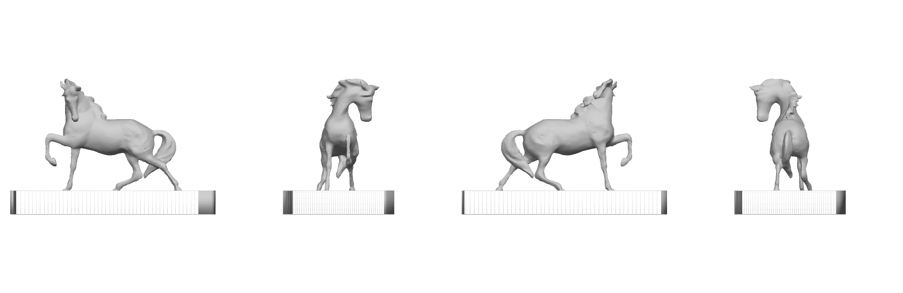
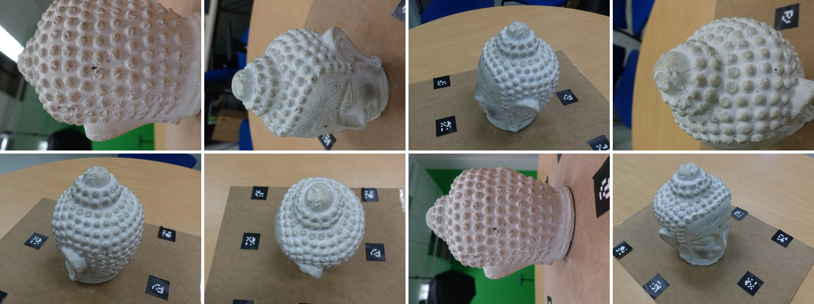
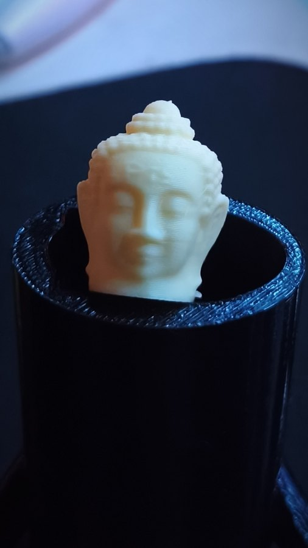
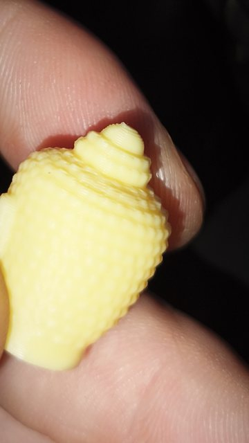

<p align="center">
  <picture>
    <source media="(prefers-color-scheme: dark)" srcset="assets/logo_chiaro.png">
    
  </picture>
</p>

<p align="center">
  <b>Giri attorno a una statua con il telefono e la stampi.</b><br>
  Da foto o video a un modello chiuso, in scala e già impostato per Bambu Studio.
</p>

<p align="center">
  <a href="https://github.com/MarcoLobby96/Effigie/releases"></a>
  
  
</p>

<p align="center">
  
</p>

## Perché esiste

COLMAP e OpenMVS ricostruiscono bene, ma restituiscono una nuvola di punti con dentro tutto quello che le foto hanno visto: pavimento, alberi, piedistallo. Trasformarla in un oggetto stampabile vuol dire ore di MeshLab, Blender e tentativi nello slicer.

Effigie fa quella parte da solo. Alla fine c'è un file che si apre in Bambu Studio dritto, centrato, all'altezza scelta, con supporti, pareti e brim già decisi.

## Un esempio reale

<p align="center">
  
</p>

Cavallo di bronzo su un piedistallo, ripreso all'aperto con il sole basso. È la scena *Horse* del dataset pubblico [Tanks and Temples](https://www.tanksandtemples.org): fotogrammi di un video a 1920 × 1080.

- **151 fotogrammi** in ingresso: **27 scartati** in automatico perché sovraesposti contro il cielo, 124 usati.
- Il cavallo scuro sul piedistallo chiaro esce staccato dalla base. Effigie tiene tutti e due i pezzi invece di buttare il soggetto.
- Il piedistallo è stato tagliato a mano con un solo colpo di forbice nell'app. La cima, vista solo dall'alto, era una lastra bucata ed è diventata un plinto pieno e piatto.
- Risultato: 151 × 82 × 100 mm, chiuso, 236 cm³. Impostazioni scelte: strato 0,16 mm, supporti ad albero solo dal piatto per 14 cm² di sporgenze, nessun brim perché il plinto appoggia su 113 cm².
- Circa **75 minuti** in qualità alta su un Ryzen 5 7600.

## Stampato

Il Buddha del dataset AliceVision, ricostruito con Effigie e stampato su una Bambu Lab A1.

<p align="center"></p>
<p align="center"><sub>8 delle 67 foto del dataset.</sub></p>

<p align="center">
  
  
</p>

## Con i colori delle foto

Una volpe impagliata appesa al muro: 50 fotogrammi di un video fatto col telefono, dalla scena di prova *fox* di instant-ngp. Effigie riconosce la parete e lascia il retro piatto, così si stampa sdraiata senza supporti. I colori vengono proiettati dalle foto sul modello e finiscono nel `GLB` e nell'`USDZ`.

<p align="center"></p>

## Cosa fa al posto tuo

| Problema | Cosa fa Effigie |
|---|---|
| Foto adatte o no? | Appena scegli le foto dà un voto da 1 a 10 con i motivi: numero, risoluzione, nitidezza, esposizione, sovrapposizione, dettagli riconoscibili. Dopo l'allineamento dice quante foto si sono agganciate davvero. |
| Foto mosse, buie o bruciate | Le scarta prima di partire, se ne restano abbastanza, e scrive il motivo in `qualita.json`. Dai video prende i fotogrammi più nitidi. |
| Sfondo, pavimento, tavolo, parete | Trova i piani con RANSAC e ritaglia attorno al punto che le camere guardavano. Una parete diventa un retro piatto da appendere. |
| Modello storto o sottosopra | La verticale viene dal pavimento o dalle camere; il davanti dal volto, se c'è, o dal lato lungo dell'oggetto. |
| La "bolla" di Poisson e le membrane | Base tagliata al punto reale più basso, membrane lontane dai dati rimosse. |
| Pezzi sottili che non si stampano | Controllo degli spessori: se troppa superficie è sotto 1,2 mm, aumentano le pareti. |
| Impostazioni dello slicer | Il `3MF` contiene altezza strato, riempimento, supporti e brim calcolati da volume, sporgenze e superficie d'appoggio, pensati per la Bambu Lab A1. |
| Rifiniture | Levigatura, altezza, orientamento, simmetria e tagli si aggiornano in pochi secondi, perché la superficie già calcolata viene riusata. |
| Difetti da sistemare a mano | Pennelli Leviga ed Erodi con dimensione e intensità, «Base qui» per rendere piatta la zona che poggia sul piatto, rotazione libera e Ctrl+Z, tutto dentro l'app. |

Esporta anche `STL`, `GLB` con i colori delle foto e `USDZ` per vedere il modello in realtà aumentata sul telefono.

## Il computer che serve

Tutto il calcolo gira sul processore. Effigie è provato su un Ryzen 5 7600 (6 core) con 32 GB di memoria. Un progetto occupa parecchio spazio: il cavallo, in qualità alta, arriva a 6 GB.

| Qualità | Lato foto | Profondità Poisson | Facce |
|---|---|---|---|
| bozza | 1280 px | 9 | 150k |
| media | 1600 px | 10 | 300k |
| alta | 2400 px | 11 | 800k |

## Installazione

**Installer:** scarica `Effigie-Setup` dalle [Release](https://github.com/MarcoLobby96/Effigie/releases). Include Python, COLMAP, OpenMVS e FFmpeg; non servono diritti di amministratore.

**Da sorgente:**

```bat
git clone https://github.com/MarcoLobby96/Effigie.git
cd Effigie
"Avvia Effigie.bat"
```

Al primo avvio lo script installa quello che manca, Python compreso.

## Come fotografare

- **50–100 foto**, girando attorno al soggetto in 2–3 giri ad altezze diverse. Il soggetto resta fermo, ti muovi tu.
- Luce diffusa: cielo coperto o ombra. Il sole basso alle spalle del soggetto brucia le foto: nel cavallo se ne sono perse 27.
- Superfici lucide, trasparenti o tutte uguali (vetro, cromo, muro bianco) non si ricostruiscono.
- Per una persona: qualcun altro gira con il telefono e chi viene ripreso sta immobile. I selfie non funzionano.

Poi: trascina la cartella o il video nella finestra, scegli altezza e qualità, avvia. Rifinisci con gli strumenti laterali e apri in Bambu Studio. La guida completa è nell'app, alla voce *Come si fa*.

## Limiti

- Solo Windows.
- Le parti mai inquadrate (sotto, dietro un muro) vengono chiuse alla meglio. L'opzione sperimentale *Immagina le parti non viste (IA)* le fa riempire a TripoSR e lascia il resto com'è nelle foto.
- Se le foto non si allineano, Effigie non inventa un modello di nascosto: con 20 foto o più chiede prima se usare l'IA, che ricostruisce una forma plausibile da una sola foto ma non una copia fedele.
- Alcuni set non si allineano anche con foto nitide, per esempio con un teleobiettivo spinto su un piatto girevole. Il voto iniziale non può prevederlo tutto: il dato certo è quello dopo l'allineamento.
- Le impostazioni di stampa sono tarate sull'A1. Il modello va bene per qualsiasi stampante, ma con le altre le impostazioni vanno ricontrollate.

## Crediti

Effigie si basa su [COLMAP](https://github.com/colmap/colmap), [OpenMVS](https://github.com/cdcseacave/openMVS), [PyMeshLab](https://github.com/cnr-isti-vclab/PyMeshLab), [trimesh](https://github.com/mikedh/trimesh), [Manifold](https://github.com/elalish/manifold), [OpenCV](https://opencv.org), [FFmpeg](https://ffmpeg.org) e [TripoSR](https://github.com/VAST-AI-Research/TripoSR). Le relative licenze sono raccolte nella cartella [`licenze/`](licenze).

Le immagini del Buddha provengono dal [Buddha Dataset](https://github.com/alicevision/dataset_buddha) di AliceVision (S. Gasparini, F. Castan, Y. Lanthony, 2017, [doi:10.5281/zenodo.1203283](https://doi.org/10.5281/zenodo.1203283)), distribuito con licenza [CC BY 4.0](https://creativecommons.org/licenses/by/4.0/).

Il cavallo è la scena *Horse* del benchmark [Tanks and Temples](https://www.tanksandtemples.org) (A. Knapitsch, J. Park, Q.-Y. Zhou, V. Koltun, *Tanks and Temples: Benchmarking Large-Scale Scene Reconstruction*, ACM Transactions on Graphics 36(4), 2017), usata secondo i [termini del dataset](https://tanksandtemples.org/license).

La volpe è la scena di prova *fox* di [instant-ngp](https://github.com/NVlabs/instant-ngp) di NVIDIA, distribuita con la [NVIDIA Source Code License](https://github.com/NVlabs/instant-ngp/blob/master/LICENSE.txt) (solo uso non commerciale).

Il teschio di `esempi/Teschio` è il set [Skull - Cameramoves - Flash - No Background](https://gitlab.com/photogrammetry-test-sets/skull-cameramoves-flash-no-background) di [alansartlog](https://alansartlog.com), con licenza [CC BY 4.0](https://creativecommons.org/licenses/by/4.0/).

## Autore

Marco Lo Bartolo
