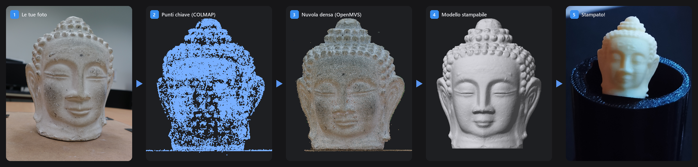
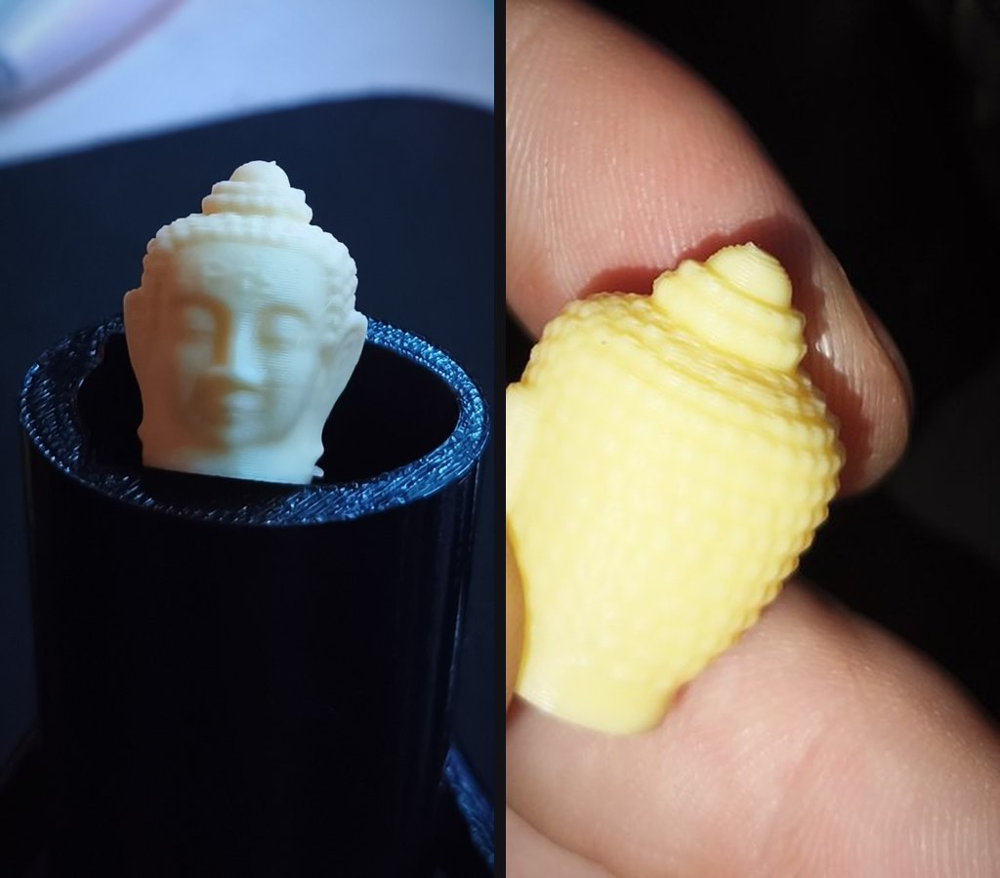
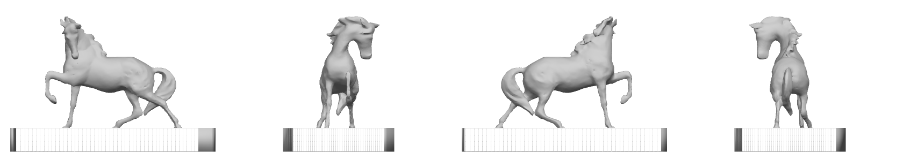
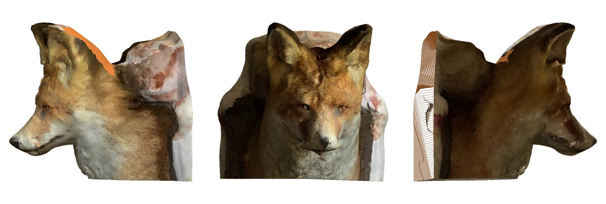

<p align="center">
  <picture>
    <source media="(prefers-color-scheme: dark)" srcset="assets/logo_chiaro.png">
    
  </picture>
</p>

<p align="center">
  <b>Fai il giro di un oggetto con il telefono e stampalo in 3D.</b><br>
  Effigie trasforma foto o un video in un modello chiuso, in scala e già impostato per Bambu Studio.
</p>

<p align="center">
  <a href="https://github.com/MarcoLobby96/Effigie/releases"></a>
  
  
</p>

<p align="center">
  
</p>

## Cosa ottieni

- **Un file pronto da stampare.** Il `3MF` si apre in Bambu Studio dritto, centrato e all'altezza scelta, con strato, riempimento, supporti e brim già decisi per la Bambu Lab A1.
- **Solo l'oggetto.** Pavimento, tavolo, parete e sfondo vengono tolti da soli. La base esce piatta.
- **Ritocchi veloci.** Levigatura, altezza, orientamento, simmetria e tagli si aggiornano in pochi secondi. Per i difetti ci sono i pennelli nell'app.
- **Tutto in locale.** Le foto restano sul tuo computer. COLMAP e OpenMVS fanno la ricostruzione sul processore.

Esporta anche `STL`, `GLB` con i colori delle foto e `USDZ` per vedere il modello in realtà aumentata sul telefono.

## Risultati

### Buddha, stampato

<p align="center">
  
</p>
<p align="center"><sub>67 foto del dataset AliceVision, ricostruite con Effigie e stampate su una Bambu Lab A1.</sub></p>

### Cavallo di bronzo

<p align="center">
  
</p>
<p align="center"><sub>151 fotogrammi da un video all'aperto, 27 scartati perché bruciati dal cielo. Il piedistallo è diventato un plinto pieno e piatto.</sub></p>

<details>
<summary>Dettagli del cavallo</summary>

- Scena *Horse* del dataset pubblico [Tanks and Temples](https://www.tanksandtemples.org): fotogrammi di un video a 1920 × 1080, con il sole basso.
- 151 fotogrammi in ingresso, 27 scartati in automatico perché sovraesposti contro il cielo, 124 usati.
- Il cavallo scuro sul piedistallo chiaro esce staccato dalla base. Effigie tiene tutti e due i pezzi.
- Il piedistallo è stato tagliato a mano con un solo colpo di forbice nell'app. La cima, vista solo dall'alto, era una lastra bucata: è diventata un plinto pieno e piatto.
- Risultato: 151 × 82 × 100 mm, chiuso, 236 cm³.
- Impostazioni scelte: strato 0,16 mm, supporti ad albero solo dal piatto per 14 cm² di sporgenze, nessun brim perché il plinto appoggia su 113 cm².
- Circa 75 minuti in qualità alta su un Ryzen 5 7600.

</details>

### Volpe, con i colori delle foto

<p align="center">
  
</p>
<p align="center"><sub>Volpe impagliata appesa al muro, 50 fotogrammi da un video col telefono. La parete diventa un retro piatto, che poggia sul piatto di stampa.</sub></p>

## Installazione

**Installer.** Scarica `Effigie-Setup` dalle [Release](https://github.com/MarcoLobby96/Effigie/releases). Contiene Python, COLMAP, OpenMVS e FFmpeg. Non servono diritti di amministratore.

**Da sorgente.**

```bat
git clone https://github.com/MarcoLobby96/Effigie.git
cd Effigie
"Avvia Effigie.bat"
```

Al primo avvio lo script installa quello che manca, Python compreso. Ci vogliono alcuni minuti.

**Che computer serve.** Effigie è provato su un Ryzen 5 7600 (6 core) con 32 GB di memoria. Un progetto occupa parecchio spazio: il cavallo in qualità alta arriva a 6 GB.

| Qualità | Lato foto | Profondità Poisson | Facce |
|---|---|---|---|
| bozza | 1280 px | 9 | 150k |
| media | 1600 px | 10 | 300k |
| alta | 2400 px | 11 | 800k |

## Come fare le foto

- Scatta **50–100 foto** girando attorno al soggetto, in 2–3 giri ad altezze diverse.
- Il soggetto resta fermo e ti muovi tu.
- Cerca una luce diffusa: cielo coperto o ombra. Il sole basso dietro il soggetto brucia le foto.
- Evita superfici lucide, trasparenti o tutte uguali, come vetro, cromo o un muro bianco.
- Per ritrarre una persona serve qualcun altro che gira con il telefono. Chi viene ripreso sta immobile. I selfie non funzionano.

Poi trascina la cartella delle foto o il video nella finestra, scegli altezza e qualità e avvia. Rifinisci con gli strumenti laterali e apri il file in Bambu Studio. La guida completa è nell'app, alla voce *Come si fa*.

## Cosa fa al posto tuo

| Passaggio | Cosa fa Effigie |
|---|---|
| Scelta delle foto | Appena le scegli dà un voto da 1 a 10, con i motivi. Dopo COLMAP dice quante foto si sono allineate davvero. |
| Foto mosse, buie o bruciate | Le scarta prima di partire, se ne restano abbastanza, e scrive il motivo in `qualita.json`. Dai video prende i fotogrammi più nitidi. |
| Sfondo, pavimento, tavolo | Trova i piani con RANSAC e ritaglia attorno al soggetto. Se l'oggetto è appeso, la parete diventa un retro piatto. |
| Orientamento | Prende la verticale dal pavimento o dalle camere. Mette davanti il volto, se lo trova. |
| Base | Taglia la base piatta al punto più basso e trasforma la lastra di un piedistallo in un plinto pulito. |
| Spessori | Controlla le parti sottili. Se troppa superficie è sotto 1,2 mm, aumenta le pareti. |
| Impostazioni di stampa | Calcola altezza strato, riempimento, supporti e brim da dimensioni, volume, sporgenze e appoggio, e le salva nel `3MF`. |
| Ritocco a mano | Pennelli Leviga ed Erodi, «Base qui» per scegliere la zona che poggia sul piatto, rotazione libera e Ctrl+Z. |

## Limiti

- Funziona solo su Windows.
- Le parti mai inquadrate, come il sotto o il lato contro un muro, vengono chiuse alla meglio.
- L'opzione sperimentale *Immagina le parti non viste (IA)* usa TripoSR per riempirle e lascia il resto com'è nelle foto. Si trova solo nell'installazione da sorgente, non nell'installer. Al primo uso scarica il modello di TripoSR.
- Se le foto non si allineano e sono 20 o più, Effigie chiede prima di usare l'IA. L'IA ricostruisce una forma plausibile da una sola foto, ma non una copia fedele. Con meno di 20 foto, se l'IA è installata, ci passa da sola.
- Alcuni set non si allineano anche con foto nitide, per esempio con un teleobiettivo spinto su un piatto girevole. Il voto iniziale non lo può prevedere sempre. Il dato certo è il numero di foto allineate.
- Le impostazioni di stampa sono pensate per l'A1. Il modello va bene per qualsiasi stampante, ma con le altre le impostazioni vanno ricontrollate.

## Crediti

Effigie si basa su [COLMAP](https://github.com/colmap/colmap), [OpenMVS](https://github.com/cdcseacave/openMVS), [PyMeshLab](https://github.com/cnr-isti-vclab/PyMeshLab), [trimesh](https://github.com/mikedh/trimesh), [Manifold](https://github.com/elalish/manifold), [OpenCV](https://opencv.org), [FFmpeg](https://ffmpeg.org) e [TripoSR](https://github.com/VAST-AI-Research/TripoSR). Le relative licenze sono raccolte nella cartella [`licenze/`](licenze).

Le immagini del Buddha provengono dal [Buddha Dataset](https://github.com/alicevision/dataset_buddha) di AliceVision (S. Gasparini, F. Castan, Y. Lanthony, 2017, [doi:10.5281/zenodo.1203283](https://doi.org/10.5281/zenodo.1203283)), distribuito con licenza [CC BY 4.0](https://creativecommons.org/licenses/by/4.0/).

Il cavallo è la scena *Horse* del benchmark [Tanks and Temples](https://www.tanksandtemples.org) (A. Knapitsch, J. Park, Q.-Y. Zhou, V. Koltun, *Tanks and Temples: Benchmarking Large-Scale Scene Reconstruction*, ACM Transactions on Graphics 36(4), 2017), usata secondo i [termini del dataset](https://tanksandtemples.org/license).

La volpe è la scena di prova *fox* di [instant-ngp](https://github.com/NVlabs/instant-ngp) di NVIDIA, distribuita con la [NVIDIA Source Code License](https://github.com/NVlabs/instant-ngp/blob/master/LICENSE.txt) (solo uso non commerciale).

Il teschio di `esempi/Teschio` è il set [Skull - Cameramoves - Flash - No Background](https://gitlab.com/photogrammetry-test-sets/skull-cameramoves-flash-no-background) di [alansartlog](https://alansartlog.com), con licenza [CC BY 4.0](https://creativecommons.org/licenses/by/4.0/).

## Autore

Marco Lo Bartolo

© 2026 Marco Lo Bartolo. Tutti i diritti riservati: il codice è visibile, ma non può essere riutilizzato o ridistribuito senza permesso. I componenti di terze parti restano sotto le proprie licenze, raccolte in [`licenze/`](licenze).
